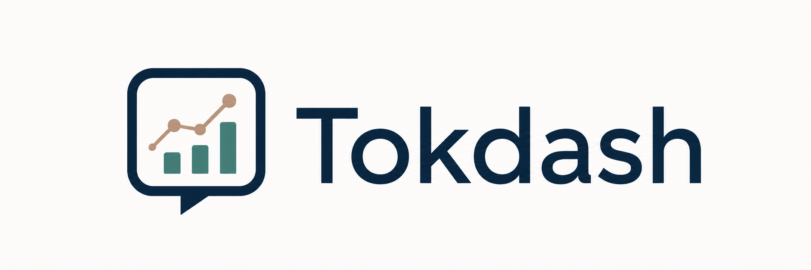

<!--
Archived README — TokenDashboard v0.6.2.
Preserved verbatim before the v1.0.0 documentation rewrite (Python-native onboarding).
For current usage see the top-level README.md; for the rewrite plan see
docs/local/20260620_python_onboard/PYTHON_ONBOARD_PLAN.md.
-->

> **Archived snapshot — TokenDashboard v0.6.2.** Kept for reference before the v1.0.0 README rewrite.

<p align="center">
  <a href="README.md">English</a> &nbsp;|&nbsp; <a href="README_CN.md">中文</a>
</p>

<p align="center">
  <a href="https://token-dashboard.github.io/"></a>
</p>

<p align="center">
  <b>Local token &amp; cost dashboard for AI coding tools</b>
</p>

<p align="center">
  <a href="https://opencode.ai/" title="OpenCode"></a>
  <a href="https://openai.com/codex/" title="Codex"></a>
  <a href="https://www.claude.com/product/claude-code" title="Claude Code"></a>
  <a href="https://github.com/google-gemini/gemini-cli" title="Gemini CLI"></a>
  <a href="https://openclaw.ai/" title="OpenClaw"></a>
  <a href="https://github.com/MoonshotAI/kimi-cli" title="Kimi CLI"></a>
  <a href="https://pi.dev/" title="Pi"></a>
  <a href="https://github.com/features/copilot" title="GitHub Copilot CLI"></a>
  <a href="https://hermes-agent.nousresearch.com/" title="Hermes"></a>
</p>

<p align="center">
  
  
  
  <a href="https://token-dashboard.github.io/"></a>
  <a href="https://token-dashboard.github.io/demo/"></a>
</p>

<p align="center">
  <b>Try it without installing → <a href="https://token-dashboard.github.io/demo/">token_dashboard.github.io/demo</a></b>
</p>

<p align="center">
  <b>v0.6.0: about 30× faster than pre-0.6.0 cold usage scans, and 15× faster than ccusage in the same local benchmark.</b>
</p>

> [!IMPORTANT]
> **Keep your history:** Claude Code and Gemini CLI delete local sessions older than ~30 days by default, so TokenDashboard's earlier months can silently shrink — a one-line config change per client prevents it ([History retention](#history-retention)).

## Table of Contents

- [Live demo](#live-demo)
- [Features](#features)
- [Supported clients](docs/SUPPORTED_CLIENTS.md)
- [Platform support](#platform-support)
- [Quick start](#quick-start)
- [Configuration](#configuration)
- [Privacy \& security](#privacy--security)
- [API (local)](#api-local)
- [Cost Accuracy Note](#cost-accuracy-note)
- [History retention](#history-retention)
- [Roadmap](#roadmap)
- [Contributing / security](#contributing--security)
- [Project structure](#project-structure)
- [License](#license)

## Features

- **Exact token counts**: Input/Output/Cache token breakdowns
- **Statusline integration** *[new]*: drop a live token-usage indicator into Claude Code's statusline (or any agent that can hit a local HTTP endpoint) — see [Quick start](#statusline-integration)
- **Custom date ranges**: Flatpickr date picker + quick range buttons (Today, Last 7 Days, This Month, etc.)
- **Contribution calendar**: 2D heatmap + 3D isometric view with Tokens/Cost/Messages metrics
- **Session explorer**: per-session drill-down for Codex, Claude Code, and OpenCode
- **10 style themes**: Elevated, Classic, Vibrant, Midnight, Paper, Liquid, Terminal, Brutalist, Arcade, Studio
- **Light & dark mode**: auto-detects system preference, manual toggle
- **PWA support**: installable as a progressive web app

<p align="center">
  <a href="https://token-dashboard.github.io/demo/">
    
  </a>
</p>
<p align="center">
  <a href="https://token-dashboard.github.io/demo/">
    
  </a>
</p>

## Live demo

A static demo of the current dashboard is hosted at
**[token_dashboard.github.io/demo](https://token-dashboard.github.io/demo/)** — no install required.
(The project home page is **[token_dashboard.github.io](https://token-dashboard.github.io/)**.)

The demo runs the unmodified TokenDashboard frontend against an in-browser shim that
returns deterministic, fully synthetic data. You can:

- switch between Overview / Sessions / Stats / Pricing tabs,
- pick any date range (or the Today / 7-day / 30-day shortcuts),
- toggle light/dark and all 10 style themes,
- drill into a synthetic Codex / Claude Code / OpenCode session,
- browse the read-only pricing database.

Source for the demo lives at
[token-dashboard/token-dashboard.github.io](https://github.com/token-dashboard/token-dashboard.github.io).
Nothing is uploaded; nothing is read from your machine.

## Platform support

- **Linux (including WSL2):** supported
- **macOS:** experimental

## Quick start

### Prerequisites

- Python **3.10+**
- One or more [supported clients](docs/SUPPORTED_CLIENTS.md) installed

### Install (pip)

```bash
pip install token-dashboard
token-dashboard serve
```

Open: `http://localhost:55423`

If port conflicts:
- `token-dashboard serve --port <port>`

If you want to access TokenDashboard from another device (recommended):
- Tailscale Serve (private to your tailnet): `tailscale serve 55423`
- SSH port-forward: `ssh -L 55423:127.0.0.1:55423 <user>@<host>`

Binding to `0.0.0.0` is possible, but **not recommended**: it listens on all interfaces and can expose the dashboard beyond your LAN (VPN/Wi-Fi/etc.). Only do this if you understand the risk and have firewall/auth in place.

### Run in background

See `docs/agents/systemd/BACKGROUND_RUN.md` for:
- Linux systemd (user service) template
- macOS launchd (LaunchAgent) template
- Optional `/health` watchdog that auto-restarts a wedged service

#### For Humans

Copy and paste this prompt to your LLM agent (Claude Code, AmpCode, Cursor, etc.):

```text
Install and configure TokenDashboard to run in the background by following the instructions here:
https://raw.githubusercontent.com/TimothyNguyen/token-dashboard/main/docs/agents/systemd/AGENTS.md

Or read the Background Run guide, but seriously, let an agent do it.
```

#### For LLM Agents

Fetch the installation guide and follow it:

```bash
curl -s https://raw.githubusercontent.com/TimothyNguyen/token-dashboard/main/docs/agents/systemd/AGENTS.md
```

### Updating TokenDashboard

If you installed TokenDashboard with pip and are running it via systemd:

```bash
# 1. Upgrade the package
pip install --upgrade token-dashboard

# 2. Restart the systemd service to pick up changes
systemctl --user daemon-reload
systemctl --user restart token-dashboard

# 3. Verify the new version
pip show token-dashboard | grep Version
systemctl --user status token-dashboard --no-pager

# 4. Test the API is responding
curl 'http://127.0.0.1:55423/api/usage?period=today'
```

View logs if needed:
```bash
journalctl --user -u token-dashboard -f
```

### OpenClaw digest (scheduled reports)

TokenDashboard can power daily/weekly/monthly OpenClaw usage reports by querying the local API on a schedule.

#### For Humans

Copy and paste this prompt to your LLM agent (Claude Code, AmpCode, Cursor, etc.):

```text
Install and configure scheduled TokenDashboard usage reports for OpenClaw by following the instructions here:
https://raw.githubusercontent.com/TimothyNguyen/token-dashboard/main/docs/agents/openclaw_reporting/AGENTS.md

Or read the guide yourself, but seriously, let an agent do it.
```

#### For LLM Agents

Fetch the installation guide and follow it:

```bash
curl -s https://raw.githubusercontent.com/TimothyNguyen/token-dashboard/main/docs/agents/openclaw_reporting/AGENTS.md
```

### Statusline integration

The local API can power a statusline item in your coding agent (Claude Code, etc.) showing live token/cost stats. Hand your agent this prompt:

> *"I would like to add a statusline item from the token-dashboard endpoint's API; it should show the total tokens used today."*

Point it at [`docs/API.md`](docs/API.md) for endpoint details and let it wire the rest.

<p align="center">
  
</p>

## Configuration

TokenDashboard is **localhost-only by default**.

- `TOKEN_DASHBOARD_HOST` (default: `127.0.0.1`)
- `TOKEN_DASHBOARD_PORT` (default: `55423`)
- `TOKEN_DASHBOARD_CACHE_TTL` (default: `120` seconds)
- `TOKEN_DASHBOARD_COMPUTE_CONCURRENCY` (default: `2`) — cap on simultaneous heavy history reparses; excess cold requests return a fast `503` instead of saturating the server under load
- `TOKEN_DASHBOARD_LIMIT_CONCURRENCY` (default: `64`) — uvicorn connection cap (backpressure)
- `TOKEN_DASHBOARD_KEEPALIVE` (default: `5` seconds) — uvicorn keep-alive timeout
- `TOKEN_DASHBOARD_ALLOW_ORIGINS` (comma-separated, default: empty)
- `TOKEN_DASHBOARD_ALLOW_ORIGIN_REGEX` (default allows only localhost/127.0.0.1)
- `TOKEN_DASHBOARD_NO_RETENTION_NOTICE` (set to `1` to silence the history-retention reminder printed on `token-dashboard serve`)

Persistent usage DB (default on):

TokenDashboard maintains a local SQLite index at `~/.token-dashboard/usage.sqlite3` by default. It stores parsed token rows and Codex/Claude session summaries so repeated dashboard and API reads can use indexed SQL instead of reparsing every source log. Source logs remain the source of truth; the DB is a local performance index, and TokenDashboard falls back to live parsing if it is disabled or unavailable.

- `TOKEN_DASHBOARD_USAGE_DB` (default: `1`) — set to `0`, `false`, `no`, or `off` to disable the persistent usage DB
- `TOKEN_DASHBOARD_DATA_DIR` (default: `~/.token-dashboard`) — base directory for TokenDashboard local state
- `TOKEN_DASHBOARD_USAGE_DB_PATH` (default: `$TOKEN_DASHBOARD_DATA_DIR/usage.sqlite3`) — explicit SQLite file path
- `TOKEN_DASHBOARD_USAGE_DB_DURABLE` (default: `1`) — keep already indexed rows if a source file temporarily disappears or a parser returns no rows; set to `0` for strict source replacement
- `TOKEN_DASHBOARD_USAGE_DB_WATCH` (default: `0`) — set to `1` to run a background sync loop inside `token-dashboard serve`
- `TOKEN_DASHBOARD_USAGE_DB_WATCH_INTERVAL` (default: `30` seconds) — sync interval for `token-dashboard db watch` and the serve-time watch loop

DB maintenance commands:

```bash
token-dashboard db status --pretty
token-dashboard db sync --pretty
token-dashboard db verify --verify-period today --pretty
token-dashboard db repair --dry-run --pretty
token-dashboard db resync --pretty
token-dashboard db watch --pretty
```

Example (remote access via Tailscale Serve; recommended):

```bash
token-dashboard serve --bind 127.0.0.1 --port 55423
tailscale serve --bg 55423
```

By default `token-dashboard serve` opens the dashboard in your browser once on startup. Pass `--no-open` to disable this (it is also skipped automatically in headless/SSH environments and in the background service templates).

## Privacy & security

- **No telemetry**: TokenDashboard does not intentionally send your data anywhere.
- **Local parsing**: usage is computed from local session files (see [supported clients](docs/SUPPORTED_CLIENTS.md)).
- **Server exposure**: TokenDashboard binds to `127.0.0.1` by default. Prefer Tailscale Serve or SSH tunneling for remote access; avoid `--bind 0.0.0.0` unless you understand it listens on all interfaces and have firewall/auth in place.

## API (local)

TokenDashboard is a local HTTP server. Common endpoints:

- `GET /api/usage?period=today|week|month|N`
- `GET /api/usage?date_from=YYYY-MM-DD&date_to=YYYY-MM-DD`
- `GET /api/tools?period=...` (coding tools only)
- `GET /api/openclaw?period=...` (OpenClaw only)
- `GET /api/sessions?tool=codex|claude|opencode|pi_agent&period=...` (append `&include_review_sessions=true` to include Codex review/permission sessions, hidden by default)
- `GET /api/stats` (contribution calendar & statistics)

Example:
```bash
curl 'http://127.0.0.1:55423/api/usage?period=today'
```

Full API reference: [`docs/API.md`](docs/API.md) — schema, parameters, and response shapes for every endpoint.

## Cost Accuracy Note

Token counts depend on what each client logs locally. Costs are computed from `src/token_dashboard/pricing_db.json` and may lag real provider pricing — use as an estimate and verify against your billing source if it matters.

## History retention

TokenDashboard reads each client's **local** session logs and also keeps a local SQLite performance index. The index can keep rows TokenDashboard has already seen, but it cannot recover logs that were deleted before they were indexed, and it is not a replacement for keeping the original client history. If a client deletes old logs before TokenDashboard syncs them, a past month can still read **lower than when you first recorded it**. Only two supported clients do this by default, and both are a one-line fix:

- **Claude Code** deletes sessions older than `cleanupPeriodDays` (**default 30 days**) at startup. Add this to your existing `~/.claude/settings.json` (and any alternate `CLAUDE_CONFIG_DIR`):
  ```json
  { "cleanupPeriodDays": 3650 }
  ```
- **Gemini CLI** deletes sessions older than 30 days. Disable it in `~/.gemini/settings.json`; if a project has `.gemini/settings.json`, make the same change there because workspace settings override user settings:
  ```json
  { "general": { "sessionRetention": { "enabled": false } } }
  ```

Every other supported client keeps history indefinitely by default. For the full per-client survey, fix details, and what the local SQLite index does and does not preserve, see **[docs/HISTORY_RETENTION.md](docs/HISTORY_RETENTION.md)**.

## Roadmap

See `docs/ROADMAP.md`.

## Contributing / security

- Contributing guide: `docs/CONTRIBUTING.md`
- Security policy: `docs/SECURITY.md`

## Project structure

```
token-dashboard/
├── main.py                 # Source entrypoint (python3 main.py)
├── token-dashboard                 # Source CLI wrapper (./token-dashboard serve)
├── src/
│   └── token-dashboard/
│       ├── cli.py
│       ├── api.py                # FastAPI routes/app
│       ├── compute.py            # Aggregation/merging logic
│       ├── dateutil.py           # Shared date-range parsing
│       ├── sessions.py           # Session explorer logic
│       ├── pricing.py            # PricingDatabase wrapper
│       ├── assets.py             # Static asset management
│       ├── model_normalization.py
│       ├── pricing_db.json
│       ├── sources/
│       │   ├── openclaw.py       # OpenClaw session log parser
│       │   └── coding_tools.py   # Local coding tools parsers
│       └── static/
│           ├── index.html        # Single-page dashboard
│           ├── theme-config.js   # Theme palettes & heatmap colors
│           └── themes.css        # Per-theme CSS overrides
└── docs/                   # Roadmap + background-run docs + agent prompts
```

## License

MIT License - see `LICENSE`.
